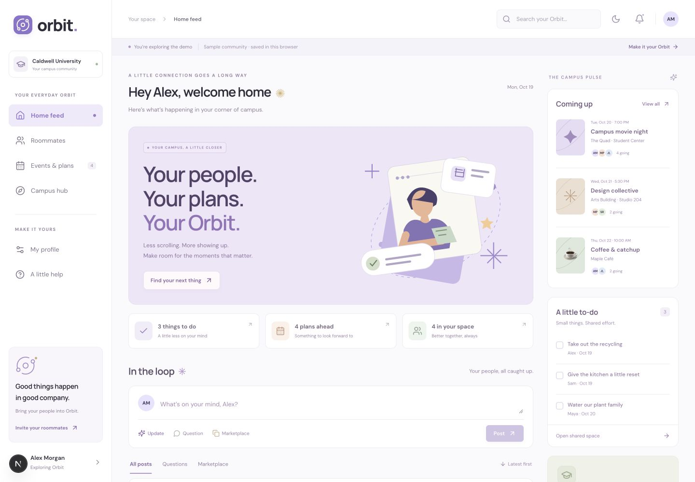

# Orbit

Orbit brings campus conversations, roommate planning, shared expenses, events, and student profiles into one place. This is a full stack Next.js application with a Supabase PostgreSQL backend and email/password authentication, ready to open in VS Code and deploy to Vercel.



## Run locally

Use Node.js **22.13 or newer** and npm. Open this folder in VS Code, then run:

```bash
npm ci
npm run dev
```

Open [localhost:3000](http://localhost:3000). Login is the landing page. Choose **Try the demo** from either the login or sign-up screen to explore Alex Morgan’s fictional campus, friends, posts, tasks, and events without an account. Demo changes stay in memory and reset when you leave or refresh; the demo never loads or writes real account data. **Back to log in** exits the preview. Connect Supabase below to enable real accounts and one-time account setup.

To check or run a production build:

```bash
npm run typecheck
npm test
npm run test:db
npm run build
npm start
```

`npm start` serves the build created by `npm run build`. `npm run dev` is for editing with live reload.

## Connect the backend

1. Create a [Supabase project](https://supabase.com/dashboard).
2. Open the project’s SQL Editor. Run the entire [initial migration](supabase/migrations/202610180001_orbit.sql) once against a new project, then [account onboarding](supabase/migrations/20261019233742_account_onboarding.sql). Existing Orbit databases only need migrations they have not already applied. Then run [campus people search](supabase/migrations/20261023030429_campus_people_search.sql), which enables a limited directory for signed-in users across separate workspaces. These create the tables, access rules, account initialization trigger, database functions, and private photo bucket. Run migrations in filename order, once each.
3. Copy `.env.example` to `.env.local` and enter your project values:

   ```dotenv
   NEXT_PUBLIC_SUPABASE_URL=https://YOUR_PROJECT.supabase.co
   NEXT_PUBLIC_SUPABASE_PUBLISHABLE_KEY=YOUR_PUBLIC_PUBLISHABLE_KEY
   ```

   Both `NEXT_PUBLIC_SUPABASE_PUBLISHABLE_KEY` and the older `NEXT_PUBLIC_SUPABASE_ANON_KEY` are supported; the publishable-key variable takes precedence if both are set. Use the public project key, never a service-role or secret key. Public keys are intended for browser use, while database policies enforce access. See [Supabase API keys](https://supabase.com/docs/guides/getting-started/api-keys).
4. In Supabase **Authentication → URL Configuration**, set the local Site URL to `http://localhost:3000` and add both `http://localhost:3000/auth/callback` and `http://localhost:3000/auth/recovery` to allowed redirect URLs. Keep the Email provider enabled. This app uses the default confirmation email flow and exchanges its PKCE code at `/auth/callback`; no custom email template is required. See [Supabase redirect configuration](https://supabase.com/docs/guides/auth/redirect-urls).
5. Restart the development server. Choose **Create an account** and enter your name, any valid email, password, major, and graduation year. Passwords require at least 8 characters, an uppercase letter, a number, and a non-whitespace special character. The signup API checks these rules on the server. Also configure Supabase Auth's password-strength settings so direct Auth API calls have equivalent protection (its strongest built-in character option also requires lowercase).
6. If email confirmation is enabled, open the confirmation link in the same browser. Complete campus-life setup (commuter, or resident with a required hall), then optionally upload a JPG/PNG/WebP photo up to 5 MB. Existing accounts also complete these new setup steps once. Progress is stored in the database; completed accounts go straight to the dashboard on future logins. Email confirmation and password recovery for ordinary users require a configured SMTP provider; Supabase's default mail service is restricted to organization team addresses.

Residence halls follow [Caldwell’s official list](https://www.caldwell.edu/residence-life/residence-halls/): Mother Joseph Residence Hall, Dominican Hall, and Rosary Hall. Residency is self-reported and does not grant extra access. Workspace membership still controls shared profiles, tasks, bills, and photos. Verified residence-based permissions are a later feature. The photo bucket is private; signed URLs last one hour and profiles use initials if a photo cannot load.

New accounts begin with an empty workspace called “My Orbit.” Create a workspace or copy its invite code from the roommate workspace settings. Another signed-in user can enter that code to join. Copying a code does not send an email or invitation. Joining or creating a workspace switches the active workspace. Its feed, tasks, and expenses remain separate; followed clubs and selected profile posts work across workspaces.

If you already use the Supabase CLI, you can apply the checked-in migration to a linked project with `supabase db push` instead of the SQL Editor. Do not apply it twice to the same database.

## Push to GitHub and deploy

1. This folder has its own local Git repository on `codex/orbit-web`. Create an initial commit in VS Code’s Source Control, then choose **Publish to GitHub**, or push it to a repository you create. No remote is configured yet. Commit `package-lock.json` and `.env.example`; `.env.local`, dependencies, and build output are ignored.
2. In Vercel, choose **Add New → Project**, import the repository, and keep the **Next.js** framework preset. The project root is this folder. Use `npm ci` to install and `npm run build` to build; leave the output directory at its default. See [Vercel Git deployments](https://vercel.com/docs/git) and [Next.js on Vercel](https://vercel.com/docs/frameworks/full-stack/nextjs).
3. Add the two environment variables above to the Vercel project. Add variables to each environment you intend to use. Changes to environment variables require a new deployment. See [Vercel environment variables](https://vercel.com/docs/environment-variables).
4. In Supabase, set **Site URL** to your actual HTTPS production origin (for example, `https://your-orbit.vercel.app`) and add both `https://YOUR_DOMAIN/auth/callback` and `https://YOUR_DOMAIN/auth/recovery` to allowed redirect URLs. Keep the localhost callback if you will continue local development. Add specific preview callbacks only for preview deployments you intend to use.
5. Deploy, then test sign-up, confirmation, sign-in, creating an item, refreshing, and joining a workspace from a second account. Database setup must be completed separately from the Vercel deployment. Existing installations need the campus people-search migration before deploying the updated search.

No GitHub repository, Supabase project, or Vercel deployment is created by this source code alone.

## Project structure

| Location | Purpose |
| --- | --- |
| `src/app` | Next.js App Router pages, authentication callback, and API routes |
| `src/components` | Responsive dashboard, feed, roommate, event, campus, and profile interfaces |
| `src/lib/types.ts` | Shared data and action contracts |
| `src/lib/demo.ts` | Fictional sample data and local demo state updates |
| `src/lib/supabase` | Browser and server Supabase clients |
| `src/lib/server` | Request validation and API response helpers |
| `supabase/migrations` | Database schema, policies, and authenticated RPCs |

`GET /api/orbit` loads the signed-in account’s active workspace. `POST /api/orbit` validates an action and executes an authenticated database transaction, returning updated data. Shared types describe the actions. Private responses use `no-store`; workspace membership is enforced in the database. Workspace activity stays within that workspace. Selected profile posts and followed-club activity use their own access rules. Task and expense deletion is limited to their creator; other workspace members can complete tasks.

## Current scope

- Home feed posts, questions, marketplace posts, likes, and comments within your shared space.
- A “Share on my profile” switch on each new or existing post. Signed-in students can open a profile and read its selected posts across workspaces. My profile’s Posts visibility switch hides the entire section. Historical posts start private; club posts never appear on a public profile.
- Saved profile visibility for major, year, bio, and posts. Public profile pages exclude email, housing, photos, workspace details, comment bodies, and lists of people who liked a post.
- Club discovery, creation, following, follower-only posts, and group chat. Following gives access immediately; there is no club approval workflow. Posts and chat are separate, with bounded history and retry-safe publishing.
- Club owners create club events. Followers see them in the club and in Events & plans alongside shared-space events.
- Going / Not going choices. Not going reveals Remove, which hides the event for that account only. Removed events can be restored from the Removed tab.
- Shared tasks, groceries, expense tracking, student profiles, workspace invite codes, campus resource links, and account onboarding.

Apply all migrations in filename order, once each. Existing installations need [profile posts and club activity](supabase/migrations/20261023130935_profile_posts_and_club_activity.sql) before deploying this update. It also requires the preceding profile visibility and clubs migrations.

The demo uses fictional people and local state that resets when you leave. Live club posts and chat are available only while following; leaving a club removes its events from your plans. Event responses and personal removals persist if you follow again. Public profile posts show text and reaction counts; reactions and comments remain within the original shared space.

Expense balances are tracking estimates; no money is transferred. Orbit is an independent student project without university systems integration. It does not send workspace invitations, direct messages, calendar invitations, or push notifications. Data refreshes after actions and periodically while visible; chat refreshes more frequently. This version uses one active workspace at a time and has no workspace switcher or invite-code rotation.

## Verification

`npm test` checks demo behavior and server validation. `npm run test:db` runs the actual migration and access assertions in disposable local PostgreSQL (PGlite), including workspace isolation, invite joins, identity checks, shared updates, and creator-only deletion. It uses an auth shim and does not connect to your Supabase project. After connecting Supabase, also test confirmation, password recovery, and two-account collaboration against your own project.

## Troubleshooting

- **Accounts are unavailable:** confirm the Supabase environment values, restart locally or redeploy on Vercel, and sign in.
- **“Accounts are temporarily unavailable” on Vercel:** set `NEXT_PUBLIC_SUPABASE_URL` and either `NEXT_PUBLIC_SUPABASE_PUBLISHABLE_KEY` or `NEXT_PUBLIC_SUPABASE_ANON_KEY` in the project's Production environment, then redeploy. Browser values are included at build time, so saving settings alone does not update an existing deployment. `/api/health` reports whether the URL and public key are present, without exposing their values.
- **A database function is missing:** run the migration in the same Supabase project referenced by your environment variables.
- **Local login works, but Vercel says the database needs setup:** check that Vercel's `NEXT_PUBLIC_SUPABASE_URL` and public key refer to the Supabase project where you ran the migrations. A different project can accept sign-ins but still lack Orbit's tables and functions. Either configure Vercel to use the existing Orbit database and redeploy, or apply both migrations in order to the intended production database. Supabase accounts and data do not transfer between projects automatically. Do not rerun the initial migration against an already-configured database.
- **Email returns to the wrong domain:** check the Supabase Site URL and allowed callback URL, then request a new confirmation email. Confirm that the deployed environment variables match the deployment.
- **Confirmation opens “Log in to Vercel”:** use the public production domains, not a protected deployment or team alias. For the existing projects, those are `https://orbit-web-amber.vercel.app` and `https://orbit-web-n.vercel.app`. Set Supabase's Site URL to a public production domain, and allow each domain's exact `/auth/callback` and `/auth/recovery` URLs. Request a new email afterward; previously sent links keep their old destination.
- **Confirmation email never arrives:** inspect Authentication logs in the Supabase project used by the deployed site. Supabase's default email service only sends to organization team addresses and has a small shared sending quota. Configure [custom SMTP](https://supabase.com/docs/guides/auth/auth-smtp) (an external email delivery provider) to support public sign-ups. Check that provider's delivery and bounce logs too. Use **Resend confirmation email** on the confirmation screen; trying to log in with an unconfirmed account also opens this screen. Resending cannot fix a missing provider or an exhausted sending quota.
- **An invite code fails:** copy all 12 letters/numbers from a real workspace. Demo codes cannot connect real accounts.

Platform setup references were checked against the linked official documentation on October 18, 2026.
